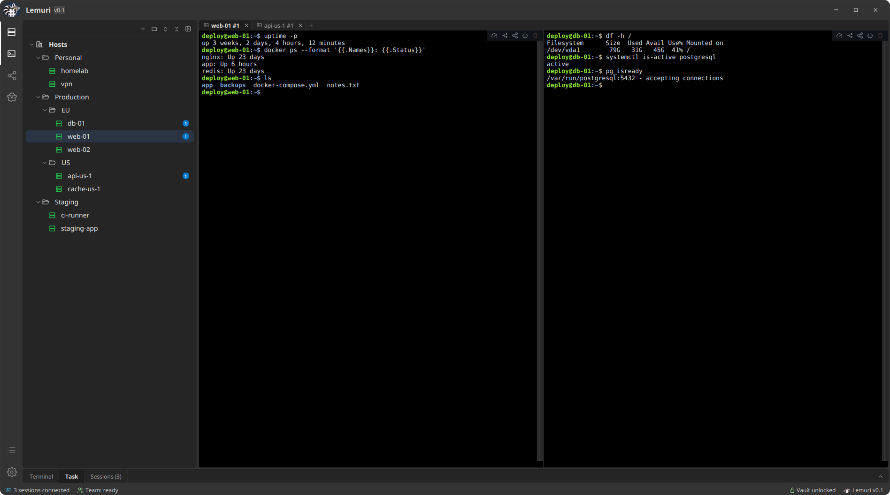

# Lemuri

**A desktop SSH console for the servers and VPS you manage.** Keep every host in one tree, open terminals in tabs, upload files over SFTP, see CPU, memory and disks, store passwords in an encrypted vault, and hand servers over to your team without pasting credentials in chat.



## Features

- **Host tree** with nested folders and live reachability; **import from `~/.ssh/config`**.
- **Real SSH terminals** (xterm.js) in tabs, split side by side or one above the other, also on different hosts.
- **Jump hosts** (ProxyJump), with every host key checked against `~/.ssh/known_hosts`.
- **Uploads over SFTP**: drag files onto a terminal, they go into the shell's current folder.
- **Encrypted vault** for host passwords; saved passwords go only to real password prompts.
- **Live metrics**: CPU, RAM, disks and uptime, read over SSH with no agent to install.
- **Team sharing**: send a host with its password, sealed for one contact and signed by you, directly over the local network or as an encrypted text for email or chat. No server, no account.
- **Ghost mode**: the window becomes a see-through panel on the desktop, which can stick to a side of the screen.
- Tray icon, light and dark themes, English and Italian.

Every feature in detail: [docs/features.md](docs/features.md).

## Build from source

There are no ready-made packages yet. It runs on Linux and macOS and needs only **JDK 21** and `unzip`: the Maven wrapper (`./mvnw`) downloads Maven on the first run.

```sh
git clone https://github.com/getlemuri/lemuri
cd lemuri
./mvnw javafx:run
```

## From any terminal

`bin/lemuri` opens an SSH shell to a saved host right in the terminal you are in, with the same address, user, key and jump hosts as the app:

```sh
ln -s "$PWD/bin/lemuri" ~/.local/bin/lemuri   # once
lemuri -s db-01          # shell on db-01
lemuri -s db-01 uptime   # just one command
lemuri -l                # the saved hosts
```

It runs the system's `ssh` with a small configuration written to `~/.lemuri/ssh/`. For hosts that log in with a password it asks for the vault password and hands the saved ones to ssh through `SSH_ASKPASS`, never on the command line; each saved password is tried once, then ssh asks you. Linux only for now (bash 4 and OpenSSH 8.4 or newer): the bash that comes with macOS is too old for it.

## Your data

Everything stays on your computer, in `~/.lemuri`:

| File | Content |
|---|---|
| `hosts.json` | hosts and folders |
| `vault.json` | the encrypted vault |
| `ssh/*.conf` | the ssh configuration written by `lemuri -s`, one per host |
| `logs/lemuri-0.log` | technical log, up to 3 files of 1 MB; attach it to bug reports. It never contains passwords or tokens, but it does name your hosts |

Preferences (theme, language, layout, local network sharing on/off) are kept by Java's preferences store, under `~/.java/.userPrefs/lemuri`.

## More

- [What runs on your servers and on the network](docs/servers-and-network.md): the background readings, the reachability probe and fail2ban, the commands typed into the terminal for you (they can be turned off in Settings).
- [Sharing hosts with your team](docs/sharing.md): contacts, sending over the network or as text, what is protected.
- [Cryptography](docs/crypto.md): the vault, the envelopes, pairing and local network deliveries, exactly.
- [Architecture](docs/architecture.md): how the code is organised.

## Roadmap and known limits

- No ready packages yet (Linux AppImage, Flatpak or .deb, macOS, Windows); when they come, they will have checksums and signatures.
- Tests cover only part of the code.
- No port forwarding yet.
- FIDO security keys (`sk-ed25519`, `sk-ecdsa`, such as a YubiKey) do not work in the app's terminals yet, and SSH certificates are untested. `lemuri -s` runs the system's `ssh`, which handles both.
- Unlocking the vault with the system keychain (Secret Service, macOS Keychain) is planned.

## Contributing and security

See [CONTRIBUTING.md](CONTRIBUTING.md). To report a vulnerability, please follow [SECURITY.md](SECURITY.md) instead of opening a public issue.

## License

[MIT](LICENSE). Third-party components are listed in [THIRD-PARTY-NOTICES.md](THIRD-PARTY-NOTICES.md).
